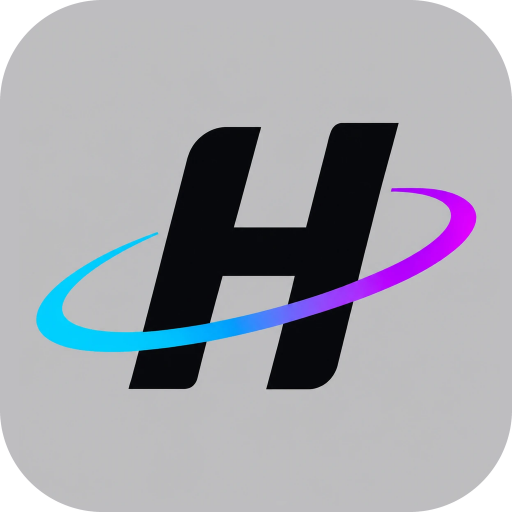
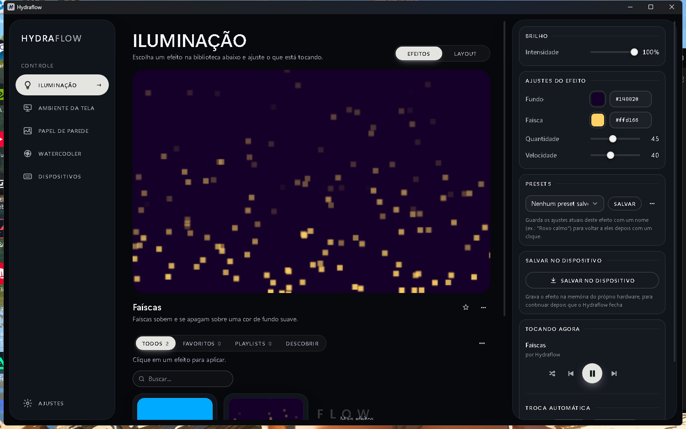
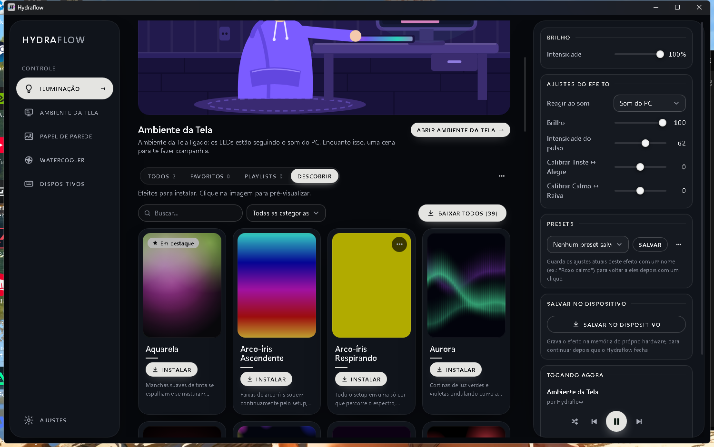
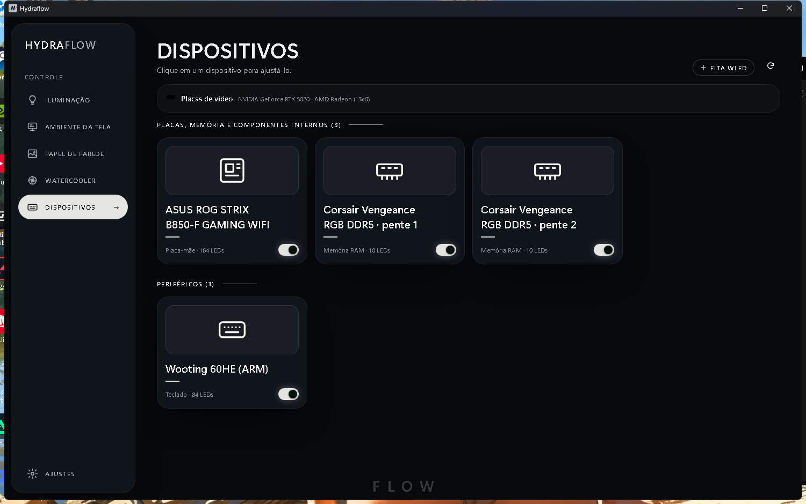
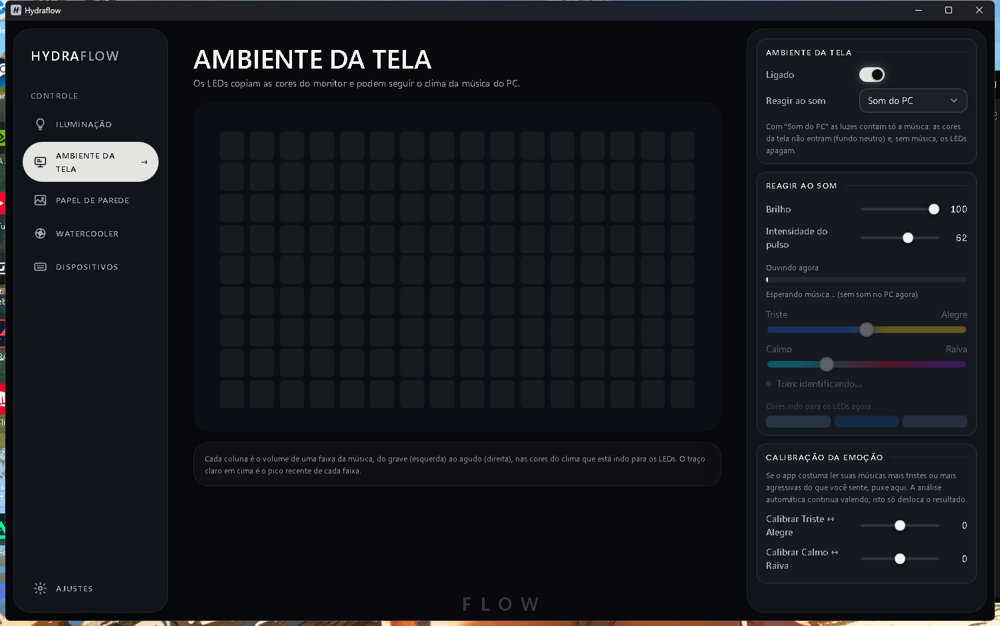

<div align="center">



# Hydraflow

**Iluminação RGB de verdade para Windows — open source, leve e feita para ficar aberta o dia inteiro.**

Efeitos animados · LEDs que copiam a tela · LEDs que seguem a música · papel de parede animado · imagem na tela do watercooler

[](../../releases/latest)
[](#)
[](https://www.electronjs.org/)
[](#idioma)

**[⬇ Baixar o instalador](../../releases/latest)** · **[🌐 Página do projeto](https://hiagoriquelmo.github.io/hydraflow/)** · **[📖 Guia completo](#guia-de-uso)**

</div>



---

## O que é

O Hydraflow é um aplicativo de código aberto para controlar a iluminação RGB do PC no Windows 11. Ele conversa direto com o
hardware (USB HID, SMBus, rede e APIs oficiais dos drivers) para tocar efeitos animados, fazer os LEDs acompanharem a tela ou
a música e colocar imagem animada no papel de parede e na telinha do watercooler.

Foi feito para ser **leve e silencioso**: roda na bandeja, quase não usa processador e não depende de nuvem, conta ou
cadastro. Nada é coletado nem enviado — só acessa a internet quando você manda baixar um efeito ou o driver da memória.

> **Aviso:** o executável não tem assinatura digital. Na primeira execução o SmartScreen pode avisar — clique em
> **Mais informações → Executar assim mesmo**.

## Pontos fortes

| | |
|---|---|
| 🪶 **Leve de verdade** | Cor Sólida na bandeja usa ~1,4% de um núcleo. A captura de tela nativa gasta ~3% com a tela mudando a 22 quadros/s. |
| 🖥️ **Ambiente da Tela de baixa latência** | Usa DXGI Desktop Duplication direto na placa de vídeo: a GPU reduz o quadro, a CPU recebe ~120×68 pixels. Medido: 17 ms da tela ao LED no teclado Wooting. |
| 🎵 **Reage à música** | O brilho segue o som do PC e as cores acompanham a "emoção" da faixa (triste↔alegre, calmo↔raiva), com calibração manual. |
| 🖼️ **Papel de parede animado** | GIF, WebP animado ou vídeo atrás dos ícones da área de trabalho, em qualquer resolução e com vários monitores. Pausa sozinho em jogos e tela cheia. |
| 💧 **Tela do watercooler** | Imagem ou GIF na tela do cooler (Gamdias AURA GL360 LCD / CHIONE), com diagnóstico claro do que está errado quando não conecta. |
| 💾 **Salva no próprio hardware** | Grava o efeito na memória do dispositivo (ASUS Aura, WLED, NVIDIA) para continuar com o app fechado. |
| 🔌 **Hardware real, sem gambiarra** | Protocolos implementados a partir de documentação pública e SDKs oficiais — sem driver de kernel não assinado, sem quebrar anti-cheat. |
| 🧩 **Efeitos em HTML** | Cada efeito é um `.html` com `<canvas>` e parâmetros em `<meta>`. Qualquer pessoa cria, compartilha e instala um efeito novo. |
| 🌍 **Três idiomas** | Português, English e Español, trocados na hora, sem reiniciar. |
| 🔒 **Sem nuvem, sem telemetria** | Configuração e biblioteca ficam no seu PC (`%APPDATA%\Hydraflow`). |

## Recursos em imagens

| Efeitos e biblioteca | Descobrir (loja de efeitos) |
|---|---|
|  |  |

| Dispositivos detectados | Ambiente da Tela e música |
|---|---|
|  |  |

## Baixar e instalar

1. Baixe o **[Hydraflow-Setup-2.0.0.exe](../../releases/latest)** na página de Releases.
2. Rode o instalador (dá para escolher a pasta, cria atalho na área de trabalho e no menu Iniciar).
3. Feche **SignalRGB, iCUE, Armoury Crate, ZEUS CAST e OpenRGB** antes de abrir: dois programas mandando no mesmo
   dispositivo causam piscadas e cores erradas.

Fechar a janela deixa o Hydraflow na bandeja, controlando os LEDs. Para sair de vez, use **Sair** no menu da bandeja.

Requisitos: Windows 10/11 x64.

---

## Guia de uso

### Efeitos
- **Todos:** os efeitos instalados. Vem só a **Cor Sólida**; o resto você baixa no Descobrir.
- **Descobrir:** os efeitos para baixar (40 que vêm com o app + fontes online que você adicionar). Baixe um por
  vez ou use **Baixar todos** (com busca ou categoria selecionada, vira **Baixar estes**). Baixado, o efeito sai
  do Descobrir e vai para Todos. Clique na imagem para pré-visualizar.
- **Favoritos** e **Playlists** (troca automática de efeito no intervalo escolhido).

### Iluminação
- **Efeito:** ajustes do efeito tocando (cores, velocidade, presets) e a troca automática.
- **Layout:** onde cada dispositivo fica sobre o efeito. Cada LED pega a cor do ponto em que está — é isso que
  faz o Ambiente da Tela funcionar: uma fita atrás do monitor, posicionada nas bordas, copia as bordas da tela.
- **Cenas Lo-Fi:** com o Ambiente da Tela tocando, o modo Efeito mostra uma de 5 cenas animadas no lugar da
  prévia (botão "Outra cena"). A prévia ao vivo continua no modo Layout, onde é preciso ver a tela para
  posicionar os LEDs. A cena gasta cerca de 5% de um núcleo; a prévia ao vivo, bem mais.
- **Salvar no dispositivo:** grava o efeito na memória do próprio hardware, para continuar com o app fechado — placa
  ASUS Aura, fitas WLED e placas NVIDIA com a API oficial. A memória Corsair e o teclado Wooting não têm gravação
  disponível (a janela explica o motivo de cada um).

### Ambiente da Tela
Liga o modo em que os LEDs seguem o monitor em tempo real.
- **Detalhe:** "Uma cor só" (o setup inteiro na cor média da tela) até "Alto" (cada região com a sua cor).
- **Saturação / Brilho:** realçam as cores (jogos costumam ter cores lavadas).
- **Suavização:** acender é imediato (o clarão de uma explosão aparece na hora); apagar é gradual.
- **Reagir a jogos:**
  - *Som do PC* — o brilho segue o volume (tiros, explosões, música).
  - *Valorant (spike)* — experimental: cada bipe da spike pisca o setup, a cor vai do amarelo ao vermelho
    conforme os bipes aceleram e na explosão tudo fica vermelho. Funciona pelo som do jogo (deixe o volume ligado).
  - A barra "Som captado agora" mostra se o som está chegando.

### Papel de Parede e biblioteca
GIF, WebP animado ou vídeo (MP4, WebM) atrás dos ícones da área de trabalho.
- **Biblioteca:** tudo que você adiciona (pelo botão ou arrastando do Explorer) é copiado para dentro do Hydraflow
  (`%APPDATA%\Hydraflow\biblioteca`). O mesmo arquivo não entra duas vezes, e apagar o original não afeta o app. A
  tela do watercooler escolhe a imagem na mesma biblioteca. Excluir um arquivo em uso avisa antes e o desliga.
- **Ajuste à tela:** *Preencher* (cobre tudo, corta as sobras), *Esticar* (cobre tudo sem cortar, pode distorcer)
  ou *Inteira* (com faixas pretas). Funciona em qualquer resolução, escala do Windows e com vários monitores.
- **Pausar em jogos e tela cheia:** para de tocar quando um jogo ou vídeo ocupa o monitor.
- Desligar devolve o papel de parede normal do Windows.

### Watercooler
Imagem ou GIF animado na tela do watercooler (480×480).
- Hoje: telas **Gamdias** (AURA GL360 LCD, CHIONE LCD) — ver *Hardware suportado*.
- A aba mostra o modelo, a porta e o firmware da tela, ou o motivo exato quando não conecta: tela ocupada por outro
  programa, sem resposta, erro de protocolo, falha no envio, modelo não suportado ou cooler ausente.
- "Tela ocupada por outro programa": só um programa por vez pode usar a tela. Feche o ZEUS CAST (ele fica na bandeja).
- "O Windows não consegue ler o cooler": a tela não está conversando com o PC pelo USB. Com o PC desligado, tire e
  encaixe de novo o cabo USB do cooler no conector USB 2.0 interno da placa-mãe, ligue e clique em **Verificar de novo**.

### Idioma
Português (Brasil), English e Español em **Ajustes → Aplicativo → Idioma**. Muda o app inteiro na hora, sem
reiniciar. Traduções em `src/locales/<idioma>/*.json` (para adicionar um idioma: copie a pasta `pt-BR`, traduza e
inclua o idioma em `LANGS`, `src/common/i18n.js`; o `npm run check` aponta o que faltar).

### Dispositivos
Lista do que foi detectado, com brilho, ajuste de cor, componentes ARGB (fans/fitas ligados em cada canal),
diagnóstico e console. Botões: **Fita WLED** (adicionar controladora de fita da rede) e a ativação do RGB das
memórias.

---

## Hardware suportado e como cada um é controlado

| Tipo | Como o Hydraflow fala com ele | Onde está no código |
|---|---|---|
| **Placas-mãe ASUS Aura** (LEDs da placa, 12 V e canais ARGB com fans/fitas) | USB HID, relatório 0xEC (protocolo próprio) | `plugins/`, motor `src/engine` |
| **Teclados Wooting** (One, Two, 60HE, 80HE…) | USB HID (protocolo do SDK aberto da Wooting) | `plugins/` |
| **Memória Corsair Vengeance/Dominator** (DDR4/DDR5) | SMBus pelo driver **PawnIO** oficial (assinado pela Microsoft) e um auxiliar com só duas operações (detectar, mandar cores) | `src/smbus/` |
| **Placas de vídeo NVIDIA com LEDs pela API oficial** (Founders Edition e parceiros que a usam) | NVAPI "Client Illumination Zones" (o driver da NVIDIA fala com a placa; nenhum acesso I2C direto) | `src/engine/gpu/nvidiaIllum.js` |
| **Placas de vídeo AMD com controlador de LEDs conhecido** (lista em `amdCards.json`) | I2C pela biblioteca oficial do driver (ADL) | `src/engine/gpu/amdAdl.js`, `amdControllers.js` |
| **Controladoras de fita na rede (ESP32/ESP8266 com WLED)** — o Ambilight caseiro mais comum | UDP "realtime" do WLED (DNRGB, porta 21324), só quando as cores mudam; volta ao efeito próprio do WLED 2 s depois que o Hydraflow para | `src/engine/engine.js` (`wled*`) |
| **Tela do watercooler Gamdias** (AURA GL360 LCD `1B80:B547`, CHIONE LCD `1B80:B53D`, variante `1D6B:0111`) | Porta COM (interface serial do próprio cooler, 115200 8N1; testado: AURA GL360, firmware V1.2.7) ou HID (relatórios de 1025 bytes); comandos texto `POST …` + JSON numa moldura 0x5A, cada um confirmado pela resposta `200`; JPEG 480×480 no modo ao vivo | `src/main/coolerLcd.js`, `docs/protocolo-tela-gamdias.md` |

Por que não um driver próprio para SMBus: o Windows só carrega drivers de kernel assinados pela Microsoft
(certificado EV + atestação). Um driver sem assinatura exigiria "modo de teste", desligaria proteções e quebraria
jogos com anti-cheat. O PawnIO oficial já é assinado e restrito. O driver é baixado da fonte oficial na hora da
ativação (a licença do instalador dele não deixa claro se pode ser redistribuído).

Adicionar hardware novo:
- **USB HID:** um plugin `.js` com a API `device.*` em `Documentos\Hydraflow\Plugins`.
- **Tela de outro cooler:** um item novo em `DRIVERS` (`src/main/coolerLcd.js`) com `detect()` e `open()`.

## Como o Ambiente da Tela captura a tela (baixa latência, pouco processador)

```
Windows (DWM) ──DXGI Desktop Duplication──► placa de vídeo: copia o quadro e gera mipmaps (média 2×2 repetida)
            só o nível ~120×68 vem para a CPU ──► processo "Hydraflow Captura" (src/capture/dxgiCapture.js)
  ──► janela (src/renderer/js/screenSource.js): saturação, brilho, suavização, reação ao som
  ──► só as cores sob os LEDs (poucos centenas de bytes) ──► motor ──► HID / SMBus / WLED / placa de vídeo
```

- O Windows entrega um quadro **só quando a tela muda**; com a tela parada, nada é processado. Cada quadro é lido
  assim que é apresentado (até 125/s).
- Cada dispositivo HID escreve na sua própria thread (`src/engine/hidWorker.js`), sempre o quadro mais recente:
  um dispositivo lento não atrasa os outros.
- Medido (pior caso, todos os LEDs mudando 60×/s): teclado Wooting 17 ms da tela ao LED, memórias <1 ms até o
  auxiliar, placa ASUS ~60 ms (limite da própria controladora; medição da 1.x — o diagnóstico ao vivo saiu na 2.0).
  Detalhes em `docs/decisoes-refatoracao.md`.
- A redução é feita pela placa de vídeo (média de verdade de cada região, sem cintilar com textos e cursor).
- Cada quadro novo é processado assim que chega (sem esperar um relógio), e o motor só escreve no hardware
  quando a cor muda.
- Chamadas COM do Direct3D feitas por índice da vtable via `koffi` — sem módulo nativo para compilar.
- Se a captura nativa não estiver disponível (área de trabalho remota, placa sem suporte), o app usa a captura
  do Chromium automaticamente.
- Medido neste PC (1920×1080): captura nativa ~3% de um núcleo com a tela mudando a ~22 quadros/s.

Outras medições (app na bandeja): Cor Sólida ~1,4% de um núcleo; papel de parede com vídeo visível ~6,5%
(processo separado com a placa de vídeo ligada; pausa em tela cheia).

---

## Compilar (build)

Pré-requisitos: Windows 10/11 x64, [Node.js](https://nodejs.org) 20 ou mais novo (inclui o npm), Git opcional.

```powershell
npm install
```
Se o npm pedir aprovação de scripts de instalação (koffi, node-hid, electron-winstaller), aprove — eles baixam
os binários nativos já compilados. Se o Electron não tiver sido baixado: `node node_modules/electron/install.js`.

```powershell
npm start
```
Abre o app em modo de desenvolvimento (`--remote-debugging-port=9222` permite inspecionar pelo DevTools).

```powershell
npm run check
```
Verificação sem hardware: todos os plugins carregam e renderizam, todos os efeitos (incluídos e do Descobrir)
são lidos com parâmetros válidos, o protocolo da tela Gamdias gera os bytes esperados, os três idiomas têm os
mesmos textos, e o motor só troca com o app as mensagens declaradas em `src/engine/protocol.js`.

```powershell
npm run dist
```
Gera em `dist\` o instalador `Hydraflow-Setup-<versão>.exe` (com termos de uso, atalho na área de trabalho) e
a versão portátil. A versão vem de `package.json`.

```powershell
npm run icon
```
Regera o ícone a partir de `build/icon.svg` (40 px para cima) e `build/icon-small.svg` (16–32 px): cria
`build/icon.ico` com 10 tamanhos, `build/icon.png` (512 px) e `build/icons/*.png`. Usa o Electron do projeto
para desenhar os SVGs, sem dependência extra.

## Estrutura

```
src/main        processo principal: janela, bandeja, store (config.json), biblioteca de efeitos e de mídia,
                Descobrir, RAM (PawnIO), tela do watercooler (coolerLcd.js), migrações de versões antigas
src/engine      motor de dispositivos (utilityProcess). engine.js só coordena; cada fonte de dispositivos é um
                provedor em providers/ (plugin HID, ram, wled, gpu) com a interface descrita em
                devices.js. Mensagens com o app: protocol.js (conferidas pelo npm run check)
src/capture     captura de tela DXGI (utilityProcess)
src/wallpaper   papel de parede animado (processo Electron próprio, atrás dos ícones)
src/smbus       auxiliar elevado do SMBus (memória RAM)
src/renderer    interface; efeitos rodam em iframe sandbox (effect-host.html); screenSource.js, soundReact.js
effects/        efeitos que vêm instalados (Cor Sólida, Ambiente da Tela)
efeitos-extras/ pacote do Descobrir (index.json + efeitos + capas)
plugins/        dispositivos virtuais de teste
docs/           decisões de arquitetura e o protocolo da tela Gamdias
scripts/check.js  verificação sem hardware
```
Dados do usuário: `Documentos\Hydraflow\{Effects,Plugins,Components}` e `%APPDATA%\Hydraflow`.

## Formatos
- **Efeito:** `.html` com `<canvas id="exCanvas" width="320" height="200">` e parâmetros em
  `<meta property="x" label="..." type="number|boolean|color|combobox|hue|textfield" min max values default>`.
  Os valores viram variáveis globais; `on<prop>Changed()` é chamada quando o valor muda.
- **Fonte de efeitos (Descobrir):** um `index.json` publicado em `https://` com
  `{ "name", "effects": [ { "id", "name", "publisher", "category", "tags", "version", "file", "image", "description" } ] }`.
  Subir a `version` mostra **Atualizar** para quem já tem o efeito.
- **Componente ARGB:** `.json` com `LedCount`, `Width`, `Height`, `LedCoordinates`, `LedMapping`, `LedNames`.

## Créditos de protocolos
- Wooting: SDK aberto da Wooting (wooting-rgb-sdk, MPL-2.0); código do plugin próprio.
- Memória Corsair: implementação própria a partir dos fatos de protocolo documentados no OpenRGB.
- PawnIO (namazso): driver assinado e módulos SMBus, baixados das versões oficiais.
- WLED: protocolo "UDP realtime" documentado pelo projeto WLED (MIT).
- Tela Gamdias: levantado por análise estática do ZEUS CAST (ver `docs/protocolo-tela-gamdias.md`).

## Projetos recomendados

- **[ResetExplode](https://github.com/GustavoReset/ResetExplode)** — suíte de diagnóstico e otimização para Windows
  (sensores, benchmarks, limpeza, drivers, overlay), de **Gustavo Reset**. Faz um belo par com o Hydraflow:
  um cuida do PC, o outro cuida da luz. Licença MIT.

## Licença

MIT — veja [LICENSE](LICENSE).

Windows e DirectX são marcas da Microsoft. Hydraflow não é afiliado à ASUS, Corsair, Wooting, NVIDIA, AMD, Gamdias
nem à WLED.
